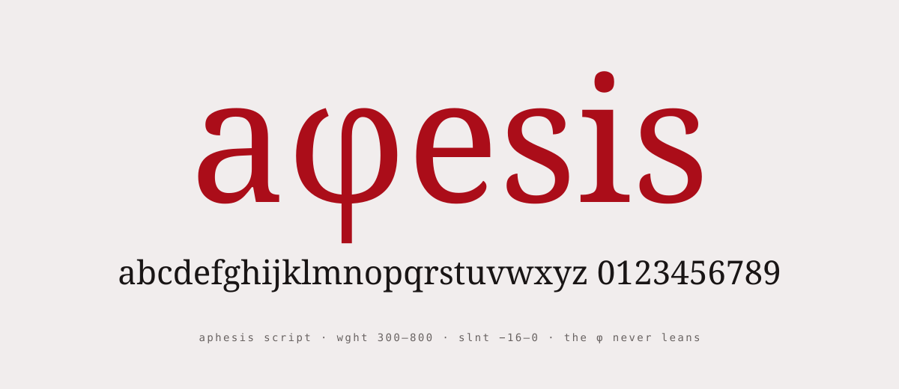

<picture>
  <source media="(prefers-color-scheme: dark)" srcset="assets/readme/font-dark.svg">
  
</picture>

# font

**Aphesis Script**, the authorial display face of aphes.ist: lowercase only, every mark drawn with the φ's brush
(broad nib at 38°, thick/thin ≈ 2.8, tapered ends, hand-moved edges). Variable axes `wght` 300–800 (400 = the φ's
own stroke) and `slnt` −16…0; the φ follows the weight and never leans.

- 721 glyphs (version 2.1): a–z, oldstyle figures (`tnum` for tabular), punctuation and symbols (¿ ¡ « » € % + = and
  more), Latin-1 accents, œ æ ß; the complete Greek lowercase with tonos, dialytika and every polytonic form of
  U+1F00–1FFF; 色即是空 drawn with the same brush. Capitals map to lowercase (capital Σ becomes σ or ς by position).
- `ss02`: a leaning φ for running Greek in slanted styles (the default φ never leans).
- Three drawings per letter, rotated by `calt`; 736 class kerning pairs, variable on both axes; `ss01` draws
  `· * # &` in the icon style (grains), for display sizes.
- Six masters, one variable font and ten static instances (Light, Regular, Medium, Bold, Black, each upright and slanted).

## On the site

<picture>
  <source media="(prefers-color-scheme: dark)" srcset="assets/readme/type-dark.svg">
  
</picture>

aphes.ist uses two faces: Aphesis Script for the wordmark, titles, headings and glosses, slanted at −12, and Special
Elite for text, which falls back to Aphesis Script for Greek and CJK.

## Files

- `src/`: the build (`python3 src/build.py`), from brush model to fonts, proofs and specimen page.
- `dist/variable/`, `dist/static/`: the fonts, TTF and WOFF2.
- `RATIONALE.md`: the spacing method, sidebearing classes, kerning, and how the system extends. `SPEC.md`: the design spec.
- `tester/index.html`: the specimen page with tester, glyph table, alternates and proofs.

## Measured spacing

Standard deviation of the white between neighbours, as a share of its mean: 3.1 % at 400 (was 27 %), 4.6 % at 300,
2.1 % at 800. fontbakery: variable 0 FAIL / 0 WARN; OpenType Sanitizer passes on all 22 files.

## Known limits

The alternate cycle runs by position in the word, not per letter. The Black closes small apertures (top left of φ,
eye of e, upper counter of 8). Slanted styles lean out of their boxes: give clipping containers padding. At 28 px on
a 1× screen the kind of breathing is hard to tell apart; browsers do not kern across Latin, Greek and Han, so keep a
space between a word and 色即是空 in slanted styles. Full list in `RATIONALE.md`.
