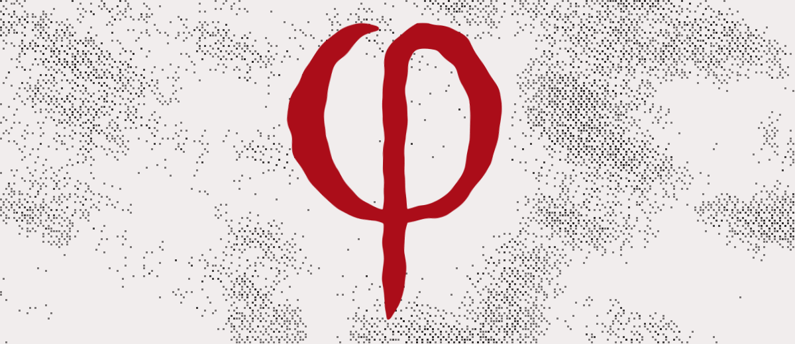

<picture>
  <source media="(prefers-color-scheme: dark)" srcset="assets/readme/mark-dark.svg">
  
</picture>

# mark

The φ of aphes.is: the hand-drawn original and the brush engine that redraws it live.

- `art/phi.svg`: the original hand-drawn φ (viewBox `69 -6 385 533`, fill `#FD1148`, even-odd). The source of truth for the mark, the brush and the font's φ.
- `engine/model.js`: the measured model (`const M`): ring edges by angle, stem, tip profile, timing.
- `engine/core.js`: the stroke engine. A centerline plus a width profile becomes a filled outline; the tip profile measured from the φ's free end travels with the pen; minimum-jerk easing and the 2/3 power law set the pen speed. It draws the φ, closes it into Φ for the corner seal, and reopens it.
- `demo/animations.html`: the standalone animation studies (drawing, φ → Φ, both anchors).

The Φ is derived from the φ by the engine; the old separate Φ drawing is superseded.

The image above draws the φ in three strokes (left lobe, right lobe, stem) and lets its ink boil: a turbulence reseeded
eight times a second, as on the site. It is an approximation for the README; the real gesture, with the measured tip
travelling and diving into the ring, is the engine's.

**Pending:** the engine's identifiers and comments are still in Portuguese; rename them to English.
