<div align="center">

<picture>
  <source media="(prefers-color-scheme: dark)" srcset="assets/readme/site-dark.svg">
  
</picture>

</div>

# site

aphes.is as one continuous page. The home and every section live in one document: entering or leaving a section
is a hash change, never a page load. One fog, one seal, one eye, one cursor, one tooltip and one passage stay for
the whole visit; the eye's theme wave keeps running across routes.
Published at https://claude.ai/artifact/XdYZE8XBH9vX6psPWHbc2y (private until shared).

## Build

```
python3 site/build.py                    # site/index.html, a self-contained page
python3 site/build.py --fragment OUT     # the same page without <!doctype>/<html>/<head>/<body>, for an artifact
python3 site/build.py experimental=REF   # build one section from another ref (a commit, origin/section/...)
```

The build copies nothing from other branches; it reads them with git:

- `design-system`: `tokens.json` (made into tokens.css), `components/bundle.css`, `components/bundle.js`, the Aphesis Script font
- `mark`: `engine/model.js` and `engine/core.js`, the live drawing of the φ
- `section/<name>`: each section, built by its own `build.py`
- Special Elite is vendored once, in `site/vendor/` (Apache License 2.0).

## The shell

- `site/src/shell.html`: the page: the fog canvas, the seal, the inscription, the host for a section, the passage, the eye.
- `site/src/shell.css`: the shell's marks, all under `aph-*` ids, so no section stylesheet touches them and they touch no section.
- `site/src/shell.js`: the home (seal, inscription, passage, eye), the routes, and the mount and unmount of sections.
- `prototype/`: the home as it was built before the merge, kept for reference.

## How the sections mount

The build runs each section branch's own `build.py --fragment` on a `git archive` of the branch and keeps three
things from it: the markup, the stylesheet (`src/<name>.css`) and the script (the section's modules, already
concatenated). Its fonts, tokens and runtime are dropped, since the page carries them once. In the page a section is

- a `<template data-sec="name">`, cloned into `#aph-host` on mount;
- a `<style data-sec="name">`, live only while the section is mounted;
- a function whose parameters (`window`, `document`, `location`, `history`, `addEventListener`, timers, animation
  frames, observers, `matchMedia`) are the shell's sandbox.

Inside the sandbox the section's runtime calls go to a scoped `Aphesis`: `Fog` hands back the shared fog (its
`zones` and `set({density, light})` drive the one fog), `seal`, `cursor` and `tooltip` are the shell's own, and
`Simulacrum` and `Typist` are tracked. The section's own `#fog`, `#seal` and `#controls` stay in its markup, so its
script finds them, but never show.

Leaving, the section's text dissolves piece by piece (each `.aph-ink` block and each mark on its own, as the
sections enter, so no ancestor is faded or filtered and the theme wave's blend stays intact) and its simulacra
dissolve into the fog. After a second everything it started is stopped: timers, frames, listeners, observers, the
runtime's own listeners, and its WebGL contexts are released. Then its markup and anything it added to the page go,
and the next section mounts. The page never holds more than the fog and two simulacrum canvases.

## Routes

| route | screen |
| --- | --- |
| `#home` or none | the home |
| `#book`, `#book/<slug>` | book, one leaf |
| `#experimental` | experimental |
| `#archive`, `#archive/<slug>` | the archive, one post (inside the archive script the post is still `#<slug>`; a bare `#<slug>` is redirected) |
| `#laboratory`, `#laboratory/<slug>` | the laboratory, one experiment |
| `#works`, `#works-<id>` | works, one work |
| `#wall` | the wall |
| `#forum`, `#forum/<id>[/<n>]` | the forum, one thread |

Escape goes up: from a section's own page to its index, from an index to the home, whenever the section itself
did not use the key. The seal always leads home.

## Refreshing a section

Every section is built from its branch at build time, so refreshing one is updating its branch ref and rebuilding.
For experimental:

```
git fetch origin section/experimental:section/experimental
python3 site/build.py && python3 site/build.py --fragment /tmp/aphesis-fragment.html
```

(or `python3 site/build.py experimental=<commit>` without moving the branch). The built page lists the commit of
each section in a comment at the top of the body.

## Adding a section

Add one entry to `SECTIONS` in `site/build.py` (id, name, gloss, line). The section's branch needs a `build.py` that
writes `--fragment OUT` with the same layout as the others: one `<style>` ending with `src/<name>.css`, the markup,
the runtime script and the section script. Its routes are `#<name>` and `#<name>/...`. Route changes also call
`Aphesis.Sound.scene(name)` (or `'home'`) where the runtime has a sound engine.
