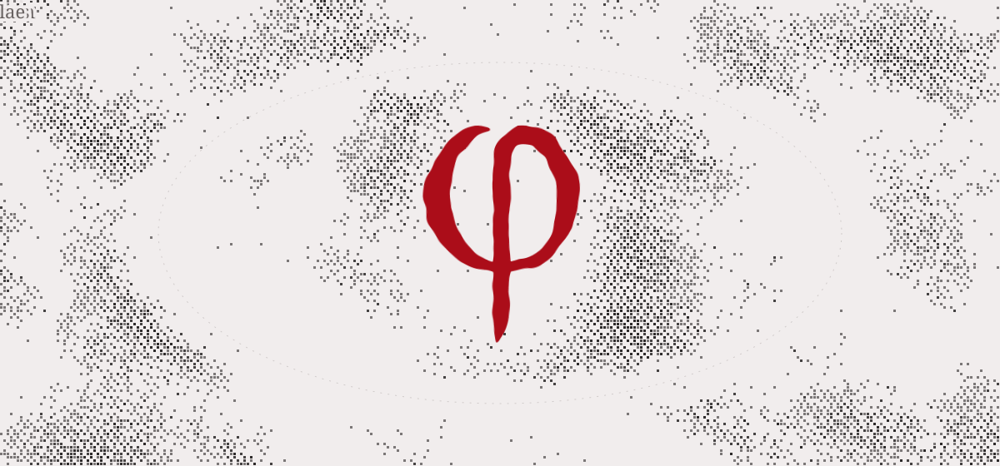

<picture>
  <source media="(prefers-color-scheme: dark)" srcset="assets/readme/hero-dark.svg">
  
</picture>

# aphesis

**aphes.ist** is an experimental, hermetic personal site. *Aphesis* is the Greek ἄφεσις, a letting go: release,
remission, the loosing of what was bound. The site is one document that never reloads: a stippled fog, a φ drawn by
hand that travels between the center and the corner, typewriter text, and a brush script for names.

This repository is the hub for all of it. Each part lives on its own branch, with its own documentation; `main` only
holds this overview, the agent rules, the map of branches, the plan and the tools for these images.

## The branches

<picture>
  <source media="(prefers-color-scheme: dark)" srcset="assets/readme/branches-dark.svg">
  
</picture>

| Branch | What lives there | Start with |
|---|---|---|
| [`main`](../../tree/main) | This hub: overview, agent rules, plan, section scopes, backlog, README tools | this file and [`docs/`](docs) |
| [`design-system`](../../tree/design-system) | The rules every screen follows: tokens, brush and stipple, icons, seal, fog, simulacra, typist, tooltip, cursor | `system/README.md` |
| [`font`](../../tree/font) | Aphesis Script: the authorial variable font drawn with the φ's brush, its source, proofs and specimen | `README.md`, `RATIONALE.md` |
| [`mark`](../../tree/mark) | The φ: the original drawing and the brush engine that redraws it and closes it into Φ | `README.md` |
| [`site`](../../tree/site) | The app: the home and its shell (fog, seal, inscription, passage, routing), later the Astro + Cloudflare project | `README.md` |
| `section/<name>` | One branch per section while it is built, cut from `site` and merged back | its own README |

The full map is in [`docs/branches.md`](docs/branches.md); what each section is, in [`docs/sections.md`](docs/sections.md).

## The look, in one screen

<picture>
  <source media="(prefers-color-scheme: dark)" srcset="assets/readme/palette-dark.svg">
  
</picture>

- **Nothing is solid.** Every mark is a brush stroke or stipple: square cells that light where a density field passes a threshold.
- **One hand.** The brush is measured from the φ: broad nib at 38°, thick to thin about 2.8, tapered ends. The icons and the font are drawn by it.
- **The fog is the ground.** Text sits on calm zones in the fog, never in boxes.
- **Red is rare.** Rubedo is for the seal, the icons and moments of impact.
- **Two faces.** Aphesis Script for the wordmark, titles and glosses, slanted; Special Elite for everything people read.
- **Lowercase, English,** with Latin and Greek glosses as the one deliberate exception.

The full system is on the [`design-system`](../../tree/design-system) branch.

## Working here

- English everywhere: code, comments, commits and documents.
- Every change goes to the branch that owns the part it changes. `main` only takes what belongs to all of them.
- Commits are made by the owner's account alone, with no co-authors and no credit lines; messages say what changed and why. See [`CLAUDE.md`](CLAUDE.md).
- Work that waits on something else is in [`docs/backlog.md`](docs/backlog.md).

## The images in these READMEs

They are animated SVGs (SMIL and CSS), drawn by [`tools/readme/make_readme_svgs.py`](tools/readme) from the design
system's tokens, the φ, the brush icons and the two fonts. Each has a light and a dark version, and GitHub picks one
from the reader's preference.
