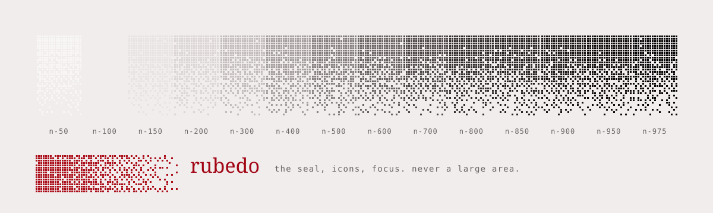
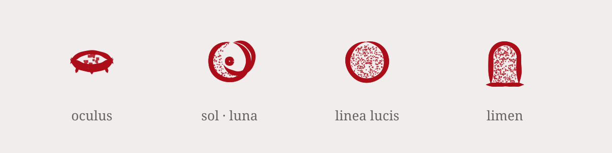

<picture>
  <source media="(prefers-color-scheme: dark)" srcset="assets/readme/simulacrum-dark.svg">
  
</picture>

# design-system

The source of truth for every screen of aphes.ist. Published as a browsable reference at
https://claude.ai/artifact/3vKR9ShjBhb3MDv8giaf7i (private until shared); this branch keeps the same files.
Read [`system/README.md`](system/README.md) before building anything.

## Color

<picture>
  <source media="(prefers-color-scheme: dark)" srcset="assets/readme/palette-dark.svg">
  
</picture>

One neutral scale with a slight red bias (hue 25), so the greys belong to the seal, and one accent, rubedo. Screens
use the role tokens (`bg`, `ink`, `ink-soft`, `line`, `fog`, `accent`, `accent-text`, `seal`), never the scale directly.
Light is "the eye open", dark is "the eye closed"; every text pair passes 4.5:1 in both.

## Type

<picture>
  <source media="(prefers-color-scheme: dark)" srcset="assets/readme/type-dark.svg">
  
</picture>

Two faces, no others. **Aphesis Script** (from the [`font`](../../tree/font) branch) sets the wordmark, titles,
headings and glosses, always slanted at −12. **Special Elite** sets everything people read and operate, and falls
back to Aphesis Script for the scripts it lacks.

## Icons

<picture>
  <source media="(prefers-color-scheme: dark)" srcset="assets/readme/icons-dark.svg">
  
</picture>

Brush strokes with stipple fill on a 24-unit grid, in rubedo, each with two states: the eye (the theme switch), sol ·
luna, the terminator, the threshold.

## Simulacra

Pictures that exist only as fog: a density map lights the same square cells as the fog, so the picture coalesces out
of it and dissolves back. They are never picture-perfect: lost points drift around the figure, fog-shaped holes open
inside it, and no area fills completely. The sources are chosen by their ground, dark and modelled: Caravaggio,
Rembrandt, La Tour, Wright of Derby, the Siena pavement, Doré, the Flammarion engraving. The research behind the
choice is in [`tools/simulacra/research.md`](tools/simulacra/research.md).

## Files

- `system/README.md`: the rules (principles, content, color, type, brush, stipple, simulacra, icons, seal, motion, interaction, layout).
- `system/tokens.json`: every token, per theme.
- `system/components/bundle.js`, `bundle.css`: the runtime every screen loads (`window.Aphesis`): brush, stipple, icons, seal, Fog, Simulacrum, Typist, tooltip, cursor, letter wave. `index.d.ts` documents the API.
- `system/components/<Name>/`: guidelines and a live preview for each component.
- `system/assets/`: the φ, the icons as SVG, the simulacra density maps.
- `system/fonts/`: Aphesis Script, variable, under the SIL Open Font License 1.1 with Reserved Font Name "Aphesis Script" (`system/fonts/OFL.txt`).
- `system/lab-kit/v1/`: the lab kit, the system as one stylesheet and an optional script for the laboratory's research viewers, served at https://aphes.ist/lab-kit/v1/ (see "Lab kit" in `system/README.md`).
- `tools/`: the bundle source before the φ path is inlined, how the density maps were made, and the lab kit's build (`tools/lab-kit/`).

## Licences

Aphesis Script is licensed under the [SIL Open Font License 1.1](system/fonts/OFL.txt) (Reserved Font Name "Aphesis Script"); the copy in the lab kit carries the same licence (`system/lab-kit/v1/fonts/AphesisScript-OFL.txt`). Special Elite keeps its own licence (`system/lab-kit/v1/fonts/SpecialElite-LICENSE.txt`). The φ mark and the wordmark `aφesis` are trademarks, not covered by either; see [TRADEMARKS.md](TRADEMARKS.md).
