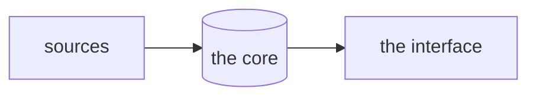

<div align="center">

<a href="https://PROJECT.aphes.ist/"><picture><source media="(prefers-color-scheme: dark)" srcset="assets/readme/header-dark.svg"></picture></a>

<picture>
  <source media="(prefers-color-scheme: dark)" srcset="assets/readme/hero-dark.svg">
  
</picture>

</div>

PROJECT takes in … and gives back …, on your own machine. (what it is: what it takes in, what it gives back, where it runs. one to three paragraphs, lowercase, no adjectives of praise.)

> the one question the project asks of its own use, if it asks one.

it is a … (an app, a command line, a server) and works with … (models or none, what it connects to).

<table>
<tr>
<td width="50%"></td>
<td width="50%"></td>
</tr>
</table>

<sub>the pictures show … (what data, and anything a reader would misread in them).</sub>

## what it does

- **a first thing.** what it does, in the reader's terms.
- **a second thing.** what it does, and how you would notice.
- **privacy by construction:** one line; the details are under privacy.

## quick start

**install** (no build needed): the installers are on the [releases page](https://github.com/aphesist/PROJECT/releases).

| system | file | notes |
|---|---|---|
| windows 10 / 11 | `PROJECT-<version>-setup.exe` | the warning the reader will meet, and the way past it. |
| macos | `PROJECT_<version>_aarch64.dmg` | the warning, and the way past it. |
| linux | `.AppImage` or `.deb` | what it needs. |

what the first launch does.

**build from source:** what it needs.

```sh
git clone https://github.com/aphesist/PROJECT
cd PROJECT
the one command that runs it
```

details: [docs/install.md](docs/install.md).

## privacy

- **local first.** where the data lives; accounts and telemetry: none.
- **what leaves.** only when, and what is logged about it.
- **keys** stay in the system's keychain.

[docs/privacy.md](docs/privacy.md) says exactly what is and is not covered.

## the evaluation

how the project measures itself, from what, and when a number is shown ("measuring" until there is enough data).

### the honesty table

| claim | status | basis |
|---|---|---|
| a claim, as a reader would quote it | **measured** | the benchmark, its n and interval, a link |
| a number computed from measurements | **modelled** | the model and its assumption |
| a property of the code | **tested** | the test |
| what it does not show | **hypothesis** | what it would take |

## architecture



## repository layout

| path | what |
|---|---|
| `src/` | … |
| `docs/` | [install](docs/install.md) · [using](docs/using.md) · [privacy](docs/privacy.md) |
| `site` branch | the landing page at [PROJECT.aphes.ist](https://PROJECT.aphes.ist) |
| `assets/readme/` | the animated pictures in this readme, drawn with the aphes.ist readme kit |

contributing: [CONTRIBUTING.md](CONTRIBUTING.md). security: [SECURITY.md](SECURITY.md).

## licence

apache-2.0 ([LICENSE](LICENSE)).

the pictures in `assets/readme/` are drawn with the aphes.ist readme kit and embed subsets of Aphesis Script (SIL Open Font License 1.1, reserved font name "Aphesis Script") and Special Elite (apache-2.0, © 2010 Astigmatic), and the project's icon, a mark of aphesist's that is not covered by this project's licence.
